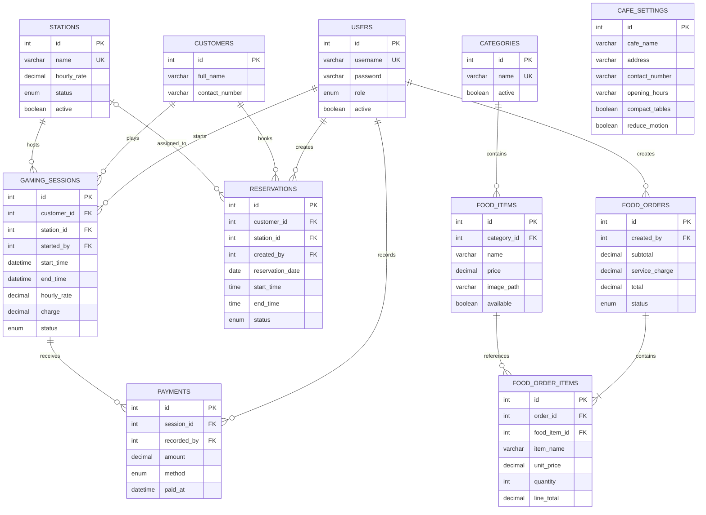

# Architecture and database relationships

Frontend → Fetch JSON/multipart → Express → mysql2 prepared statements → MySQL. Express also serves the existing HTML/CSS/JS, assets, and uploaded food images. There is no separate customer-facing client.

`station_id` is nullable for an unassigned reservation. Other displayed relationships use required foreign keys. Foreign keys prevent deleting records used by history. Cafe settings are a singleton configuration record, so they have no required business relationship. SQL setup inserts one settings row with ID 1.

Session rate and order-line name/price snapshots intentionally preserve historical bills. Payment customer IDs are derived through the gaming session instead of being duplicated. Revenue, balances, station display status, and booking display status are calculated from persisted records.
